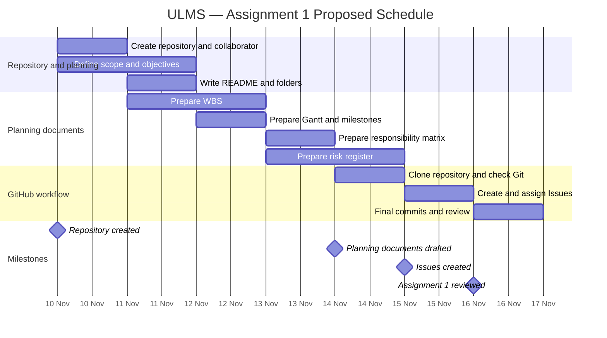

# Project Schedule — Assignment 1

> **Date note:** These are proposed practice dates starting 10 November 2026. Replace them with your real working dates and the deadline announced by your instructor before submitting. Do not present a proposed date as an instructor-issued deadline.

## Schedule Table
| ID | Activity | Start | End | Estimated effort | Owner / support | Output or milestone |
|---|---|---|---|---:|---|---|
| A1-01 | Create GitHub repository and add collaborator | 10 Nov 2026 | 10 Nov 2026 | 1 hour | Ahmad; Kahsif accepts invite | Repository created |
| A1-02 | Define scope, objectives, assumptions, and constraints | 10 Nov 2026 | 11 Nov 2026 | 2 hours | Ahmad drafts; Kahsif reviews | Project charter |
| A1-03 | Write README and repository structure | 11 Nov 2026 | 11 Nov 2026 | 1.5 hours | Ahmad | README completed |
| A1-04 | Prepare WBS and task estimates | 11 Nov 2026 | 12 Nov 2026 | 2 hours | Kahsif drafts; Ahmad checks | WBS completed |
| A1-05 | Prepare Gantt chart and milestones | 12 Nov 2026 | 12 Nov 2026 | 1.5 hours | Kahsif drafts; Ahmad checks | Schedule completed |
| A1-06 | Prepare responsibility matrix | 13 Nov 2026 | 13 Nov 2026 | 1 hour | Ahmad and Kahsif | RACI matrix completed |
| A1-07 | Identify and assess project risks | 13 Nov 2026 | 14 Nov 2026 | 1.5 hours | Kahsif drafts; Ahmad reviews | Risk register completed |
| A1-08 | Install/check Git, clone repository, and add folders | 14 Nov 2026 | 14 Nov 2026 | 1 hour | Ahmad; Kahsif verifies access | Local copy ready |
| A1-09 | Create GitHub Issues and assign major tasks | 15 Nov 2026 | 15 Nov 2026 | 1 hour | Ahmad; Kahsif checks assignments | Issues created |
| A1-10 | Make final commits and review submission evidence | 16 Nov 2026 | 16 Nov 2026 | 1.5 hours | Ahmad; Kahsif peer review | Assignment 1 ready for submission |

## Milestones
| Milestone | Target date | Completion evidence |
|---|---|---|
| M1 — Repository created | 10 Nov 2026 | GitHub repository page and URL |
| M2 — Planning documents drafted | 14 Nov 2026 | README, charter, schedule, WBS, RACI, and risks in repository |
| M3 — GitHub task tracking ready | 15 Nov 2026 | Issues page with assigned tasks |
| M4 — Assignment 1 package reviewed | 16 Nov 2026 | At least three meaningful commits and final screenshots |

## Gantt Chart
The chart below uses Mermaid syntax, which GitHub can display in Markdown. It represents this proposed Assignment 1 plan only.

## Schedule Notes
- Effort is the estimated working time, not the number of calendar days.
- Activities may overlap where practical.
- Update the dates if your actual submission deadline or team availability is different.
